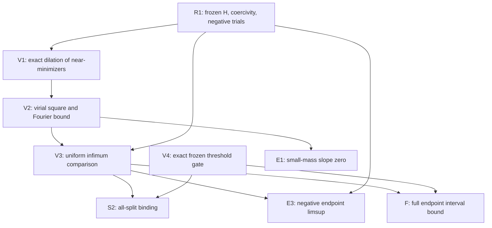
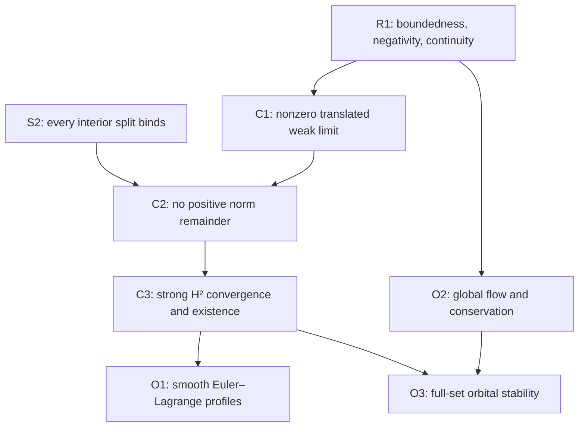

# Proof dependency audit

Date: 2026-10-23. The graph is acyclic; `proof_dependencies.json` and the claim
matrix are checked by the recorded-evidence validator. No endpoint or
monotonicity node depends on binding, compactness or existence.

| Result | Premises | Forbidden circular shortcut avoided |
|---|---|---|
| R1 | Exact frozen functional, elementary Fourier/Sobolev estimates, explicit trials | No minimizer used for negativity or continuity |
| S0 | H² approximation, locality, translation invariance | Separated trials do not refute strict binding |
| V1 | Exact dilation polynomial, arbitrary near-minimizers | No stationary profile or differentiable H² spatial orbit |
| V2 | V1, nonnegative square, direct Fourier integral | No compactness or assumed profile |
| V3 | V2, exact amplitude polynomial, I(a)<0 | Quantitative defect survives taking infima |
| E1 | V1–V2 and negative trials | No small-mass attainment premise |
| E2 | Coercivity and amplitude polynomial | Semiconcavity established without a smooth branch |
| E3 | V3 and continuity; explicit negative trial | No frozen multiplier, minimizer or binding conclusion |
| F | V3, exact D4 gate and explicit trial bound | Whole half-interval covered without an o(mu) overlap assumption |
| S2 | V3 and V4 | No existence premise |
| C1–C3 | Coercivity, negativity, power decoupling, S2 | Strong H² proved by mass and squared-A energy recovery |
| O1 | C3 and constrained calculus | Multiplier introduced only after existence |
| O2 | H² algebra, unitary group, conservation, coercivity | No numerical evolution used |
| O3 | C3 and O2 | Full-set stability proved, individual orbit uniqueness not assumed |

The inherited restricted theorem is independently checked but is not required
as a premise of V1–V3. The complete endpoint certificate covers its central
interval and the formerly open complement. Periodic D4 receipts fix inputs
and retain their original scope; periodic existence is not a premise of S2.

Conditional claims remain explicit: an interior equality would allow a
separated noncompact minimizing sequence, and individual-orbit stability
would require identification of the whole minimizing set with that orbit.
Neither conditional premise is asserted at the frozen norm.
